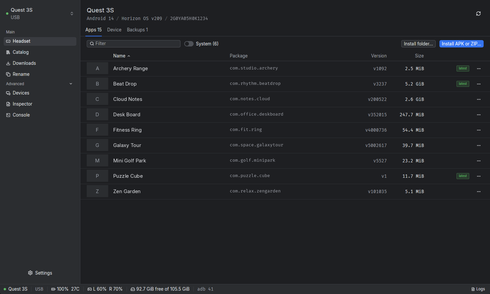
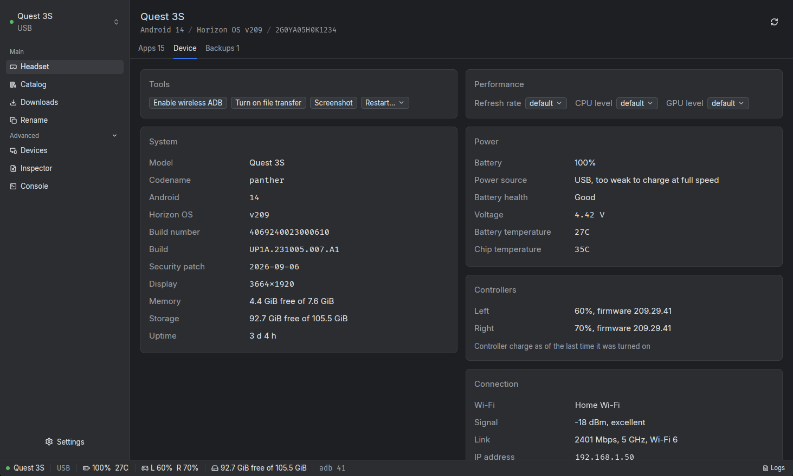
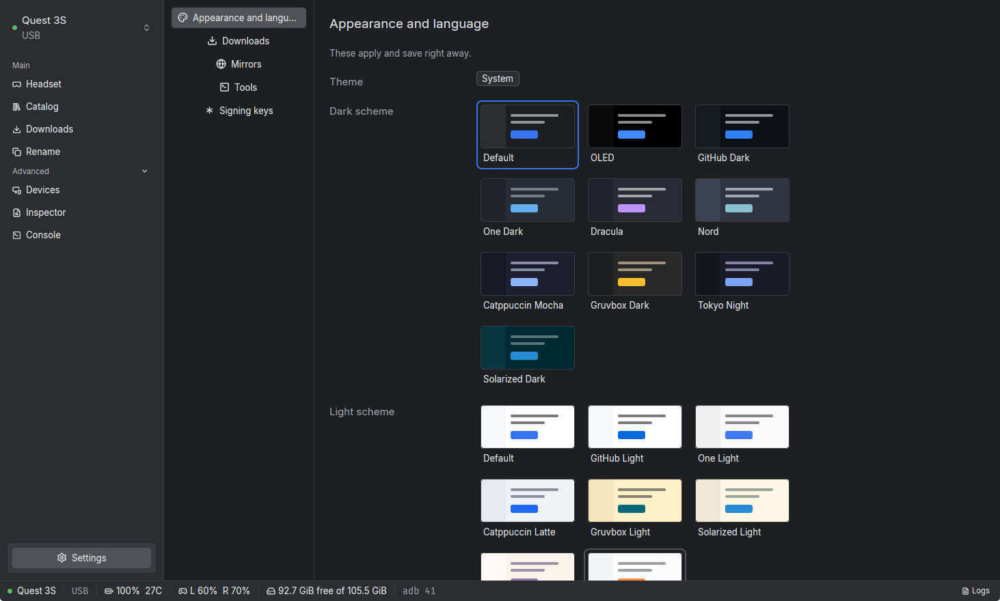

# Quest Sideloader

[](https://github.com/JonnyBro/quest-sideloader-rust/actions/workflows/ci.yml)
[](https://github.com/JonnyBro/quest-sideloader-rust/releases/latest)

Desktop sideloader for Meta Quest headsets, written in Rust with
[gpui](https://gpui.rs) and [GPUI Kit](https://gpui-kit.com). The interface is
in English, Russian and Ukrainian.



## Features

- Headset: installed apps with size, version and catalog updates; start,
  stop, back up or uninstall them. The Device page shows Horizon OS version,
  battery, temperatures, Wi-Fi, controller charge, and has wireless ADB, file
  transfer (MTP), screenshots, reboot and refresh rate/CPU/GPU levels. Save
  backups can be restored into the same app or into a renamed copy.
- Catalog: games from your mirrors as a list or a cover grid, with search,
  sorting, installed versions and available updates.
- Downloads: the task queue and the releases already on disk.
- Rename: a second copy of a game under another package name, installable
  beside the original. It needs no Java, since only the manifest, a few
  resource strings and the signature change.
- Devices, Inspector and Console: every device adb sees, what is inside an APK,
  and `adb shell` with live output.

Files, folders and ZIPs dropped on the window are installed on the selected
headset.

| Device page | Color schemes |
| --- | --- |
|  |  |

## Mirrors

The catalog is optional. Mirrors are added in Settings as a VRP-style server
config (`{"baseUri": "...", "password": "<base64>"}`), a plain HTTP mirror, or
an rclone config with a `Quest Games` folder. They are read through `rclone`.

Mirrors are run by volunteers, so the app goes easy on them. A game is only
downloaded when you ask for it, the queue holds 10, and at most 5 run at once
(2 by default). The list syncs on its own at most once a day, and interrupted
downloads resume.

When the headset has an app the catalog lacks, or a newer version, the Catalog
tab offers to upload it through the mirror's upload config. Nothing is sent
until you press Upload. An upload holds the APK, its OBB files, the headset
model and a SHA-256 of the serial.

Official builds send an API key to mirrors. It isn't in the repository, so
your own builds go without it and mirrors that require one refuse them.

## Running

- `adb`, on `PATH` or set in Settings. If it's missing, the app offers to
  download Platform-Tools from Google.
- `rclone` for mirrors. If it's missing, the app offers to download the
  official build and checks its SHA-256.
- Windows: Meta's Quest ADB driver.
- Linux: Wayland or X11, Vulkan or OpenGL, `xdg-desktop-portal` and udev rules
  for the headset (for example `android-udev`). For the window icon, copy
  `quest-sideloader.desktop` from the release archive to
  `~/.local/share/applications` and `quest-sideloader.png` to
  `~/.local/share/icons/hicolor/256x256/apps`.

Settings and data live in the platform's user folders, logs in `logs` inside
the data folder (one file a day, kept a week). For a portable copy, put an
empty `portable.txt` next to the executable; everything then goes to a
`userdata` folder beside it.

## Building

You need Rust 1.95+ and a C compiler. Also:

- Linux: `clang`, [mold](https://github.com/rui314/mold) (used by
  `.cargo/config.toml`) and the dev packages for Wayland, xcb, xkbcommon,
  fontconfig and Vulkan.
- macOS: full Xcode for the `metal` shader compiler; Xcode 26 gets it with
  `xcodebuild -downloadComponent MetalToolchain`.
- Windows: the MSVC build tools. Release builds have to run on Windows, since
  gpui compiles its DirectX shaders there; cross-builds with cargo-xwin fail.

```bash
git clone https://github.com/JonnyBro/quest-sideloader-rust.git
cd quest-sideloader-rust
cargo build --release
cargo test
```

For a local build with the API key, put it in `api_key.txt` in the repository
root (git ignores it) and run `touch crates/core/build.rs`.

`crates/core` is everything but the UI: settings, the engine, the ADB client,
the catalog, downloads and installs. `crates/app` is the gpui application.

## Credits

- [Inter](https://rsms.me/inter/)
- [Fira Code](https://github.com/tonsky/FiraCode).

The licenses are in `crates/app/assets/fonts`.

## License

GPL-3.0-only, see [LICENSE](LICENSE).
